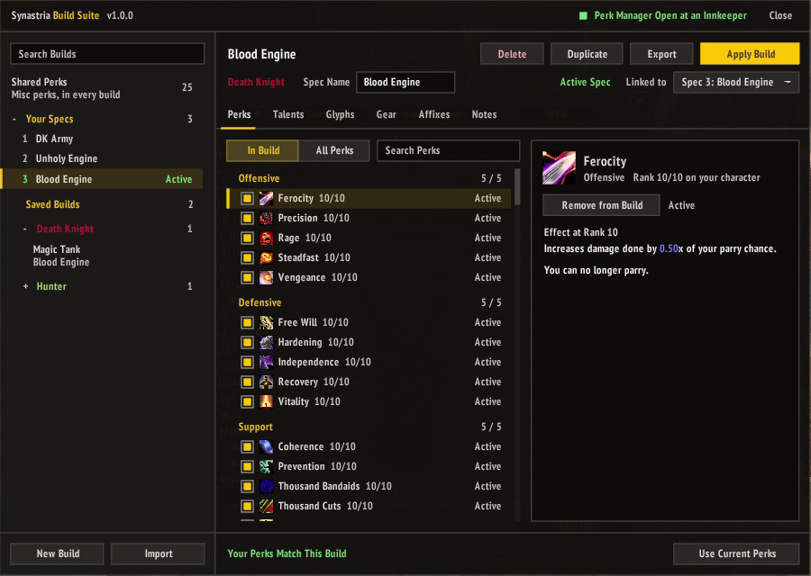
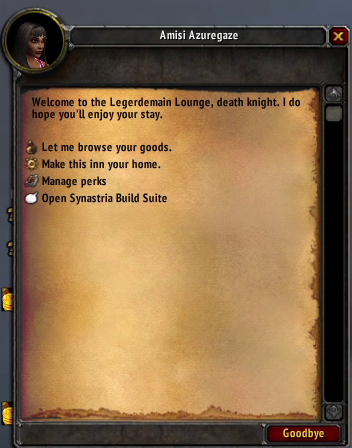
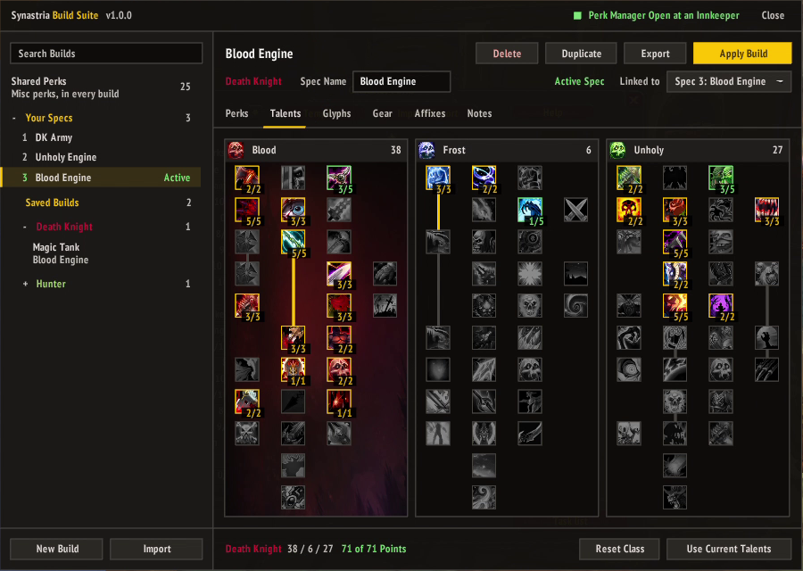
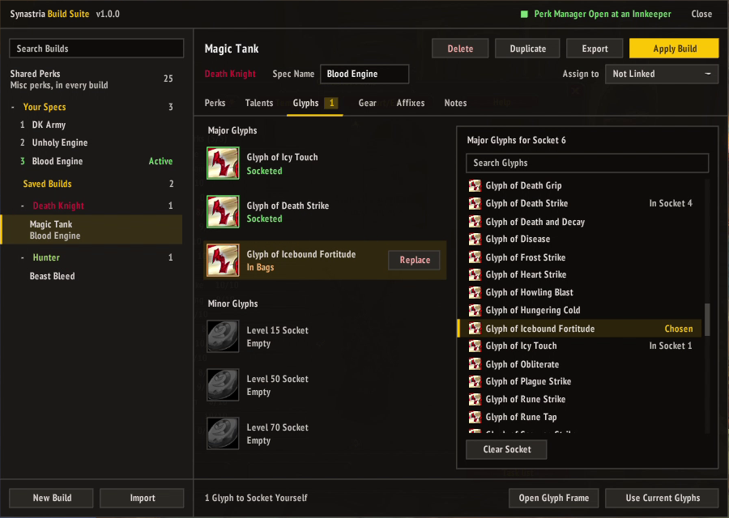
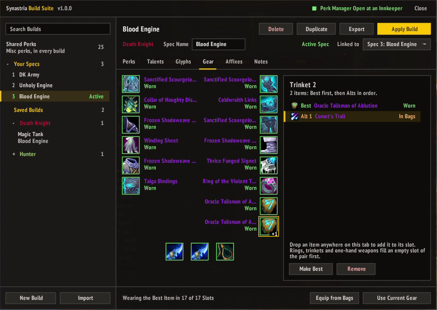
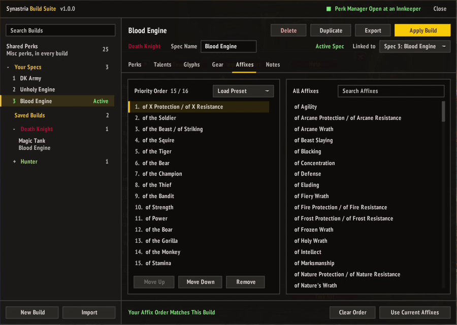

# Synastria Build Suite

A build manager for Synastria (WoW 3.3.5a). Save, share and apply a whole build in one place: perks with
their options and chosen abilities, talents for every class, glyphs, recommended gear, item affix priority,
Hunter pet aspects, the spec name and notes.

## Features

- **Save Every Spec at Once:** one click saves each of your specs as its own build, linked to that spec.
- **Plan Any Class:** start a build for any class or class pair, blank or copied from your character.
- **Review Before Applying:** Apply Build lists every change first, and nothing happens until you confirm.
- **Talent Calculator:** for any class, with Synastria's 71 points per class and dual-class builds.
- **Perk Editor:** every perk your build's classes can use, with options, chosen abilities, set bonuses and
  category limits.
- **Glyphs and Gear:** see what's socketed, worn, in your bags or missing, and equip a build's gear in one click,
  or every time you switch to its spec.
- **Hunt Gear:** have the loot filter pick up the gear your chosen builds are still missing.
- **Affix Priority:** a suggested order for the Item Affix Manager, set along with the rest of the build. Test an
  order on its own and see how your stats change, then keep it or revert.
- **Templates:** save any tab (perks, talents, glyphs, gear or affixes) by name and load it into any build.
- **Share Builds:** export the sections you choose as a single line, and import Synastria Build Suite,
  SynastriaBuildManager (SBM), SynastriaPerkManager (SPM) and Item Affix Manager strings.
- **Shared Perks:** your Misc perks live in one list that every build applies, and they're never exported or
  overwritten by an import.
- **Themes:** the flat Material look, Classic for the game's own frames and buttons, Cognac's painted gold
  frames on dark glass, or Material Glass, the Material look on see-through frosted glass.

## Installation

1. Download the latest release.
2. Extract the `SynastriaBuildSuite` folder into `World of Warcraft\Interface\AddOns`.
3. Restart the game, or log out to the character screen and back in.

## Getting Started

Open Synastria Build Suite with `/sbs`, the minimap button, or the **Open Synastria Build Suite** line in an innkeeper's chat
options. The innkeeper line also opens the Perk Manager, which perk activations need, out of sight behind the
window; closing Synastria Build Suite closes it too.

On first use, click **Add Current Specs** to save all of your specs as builds. Specs you're not in can't show
their perks or affix order yet, so those builds fill them in the first time you switch to them.

To make a single build, click **New Build**. Pick one or two classes, check what to copy from your character
(Perks, Talents, Glyphs, Gear, Affixes), name it and click **Create Build**. Leave everything unchecked to start
blank.

## The Window

- **Title Bar:** **Theme** switches between Material, Classic, Cognac and Material Glass, after a reload; Build
  Suite offers to reload for you. **Size** makes the window and its dialogs bigger or smaller, from 80% to 200%, for
  large screens or bigger text. **Snap to Pixels** keeps borders crisp; turn it off to match your UI scale exactly.
- **Sidebar:** builds linked to this character's specs are at the top under Your Specs, with the active spec
  in green. Everything else is under Saved Builds, grouped by class. Search filters by name or spec name.
- **Build Header:** click the name to rename it or set the spec name. Assign To links a build to one of your
  specs. **Apply Build** opens a review of everything that would change; for a spec you're not in, it becomes
  **Switch to Spec N**. **Export**, **Duplicate** and **Delete** sit beside it.
- **Tabs:** Perks, Talents, Glyphs, Gear, Affixes and Notes. A badge on a tab counts what differs from your character.
- **Use Current:** each tab's Use Current button copies that part of your character into the build, only for
  the build's classes you have.
- **Templates:** the menu at the right of the tabs saves the open tab as a named template, shared by all your
  characters, and loads one into any build, so you can try variations without making copies of the whole build.
  Like an export, a template keeps the whole tab, both classes of a two-class build included. Loading one replaces
  only its classes' part: a Hunter talent template loaded into a Hunter/Paladin build leaves the Paladin talents
  alone. Perk templates load into any build that can use every perk in them, and replace the general perks too.
  Gear and affix templates fit any build. After loading one, **Undo Load** at the top of the menu puts the tab back as it was.
  **Manage Templates** renames and deletes them.

### Perks

In Build lists the build's perks; All Perks lists every perk its classes can use. Check a perk to add it, then
click it to set its options or chosen ability. Category headers count the build's perks against your limits,
and perks in a set show the set's bonuses. Misc perks are kept in **Shared Perks**, at the top of the sidebar.

Perk activations need the Perk Manager open at an innkeeper; the title bar shows whether it is. Perk options
and chosen abilities apply anywhere.

### Talents

Left-click adds a point, right-click removes one, with the same tier and prerequisite rules as the talent
window. Dual-class builds get a button per class. Talents can only be added, so if your spec has points the
build doesn't, the review lists them; unlearn at a class trainer and Synastria Build Suite reopens the review.

### Glyphs

Each socket shows green when that glyph is socketed, yellow when it's in your bags and red when you don't have
it. Click a socket to pick a glyph; right-click to clear it. Dual-class builds have glyphs per class.

When a build's glyph is in your bags and you're in its spec, its socket shows a **Socket** button that sockets it
for you (glyphs are used up when socketed). If the socket already holds a different glyph, the button says
**Replace** and asks for a second click, since the old glyph is destroyed. The buttons hide in combat. **Open Glyph
Frame** opens the game's window for anything else, such as removing a glyph.

### Gear

A paper doll of the build's Best item per slot, plus Alts in order of preference. Drop an item anywhere on the
tab to add it to its slot. Items the build's classes can't use are refused. **Equip from Bags** puts on the
highest-ranked item you're carrying in each slot.

Check **Equip on Spec Change** on a build to have its gear put on from your bags whenever you switch to the spec
it's linked to, and when you apply it. In combat it waits until combat ends. Afterward it lists any slot where you
have none of the build's items, so you know what's missing. To wear the same ring or trinket in both slots you
need two copies. It's off for every build until you check it.

Check **Hunt Gear** on a build to have Synastria's loot filter pick up its gear you don't own yet (not worn, in
your bags or in your bank). The addon keeps its own **SBS Gear** rules at the top of your loot filter, ahead of
rules that would sell those items, and never changes your other rules. Only builds with Hunt Gear checked are
hunted. **Sync Loot Filter** updates the rules, and once a hunted item is yours it's dropped from them. Before each
change the addon keeps a copy of your filter; `/sbs lootfilter restore` puts it back.

**Sources** lists the build's gear you don't own yet, grouped by zone and then by boss, quest or vendor, with drop
chances from Synastria's loot database, so you can see which runs cover the most. Click an item to open it in the
Loot Database.

### Affixes

An item can have several of its affixes attuned, but only one is active at a time. The server picks the first
one in your spec's affix order, the same 16 slots as the game's Item Affix Manager. The left side is the build's
order, most wanted first: drag an affix up or down to change its place, and select one to remove it or right-click
it to remove it.
**Load Preset** starts from one of the game's orders (Strength DPS, Agility DPS, Tank, Caster). The right side
lists every affix with its stats on hover, the biggest first, each with its share of the item's affix budget: on
the same item, a bigger share is more of that stat, so a single-stat affix gives the most. Click one to add it to
the end. Search finds affixes by name or by a
stat they give ("haste", "stamina"), and the stats filter beside it shows only affixes that give any of the stats
you pick. Pick just one and the affixes giving the most of it come first, with their share beside them.

The affix order belongs to the spec and only changes near an innkeeper; the Perk Manager doesn't need to be open.
Apply Build sets it along with the rest of the build. A build with no affix order leaves yours alone.

**Test Affixes** sends just the build's affix order and shows **Your Stats**: your character's stats, grouped
like the character sheet. Your stats are noted before the order goes out, so once the server
has switched your affixes, each stat shows how much it went up or down. Don't like it? **Revert** puts back the
order you had before, in your spec and in the build, and the changes drop back to nothing. Click the Changes Since line to stop showing changes.

## Sharing Builds

**Export** shows the build as a single line, with checkboxes for the sections to include. Click **Select All**,
then press Ctrl+C to copy.

**Import** takes a pasted string, shows which sections it has and lets you pick which to bring in. **Import as
New** makes a new build; **Into** replaces just those sections of the selected build.

Import reads:

- **Synastria Build Suite** strings.
- **SynastriaBuildManager** (SBM3 and SBM2): perks, talents for each class, chosen abilities and pet aspects.
- **SynastriaPerkManager** (SPM): perks and their options. SPM strings only carry perks, so importing one
  **Into** an existing build is the handy way to use it.
- **Item Affix Manager** exports: the game's own affix order strings. Like SPM strings, they're best imported
  **Into** a build.

Misc perks are left out of every import and export, so your Shared Perks only change when you change them.

## Commands

| Command | Does |
|---|---|
| `/sbs` | Opens or closes the window |
| `/sbs help` | Lists the commands |
| `/sbs list` | Lists saved builds |
| `/sbs save <name>` | Saves your active spec as a build |
| `/sbs specs` | Saves every spec as a build linked to it |
| `/sbs apply <name>` | Lists what would change in chat, then asks before applying |
| `/sbs export <name>` | Opens the export box for a build |
| `/sbs import` | Opens the import box |
| `/sbs gear <name>` | Shows each slot: worn, in bags or missing |
| `/sbs equip <name>` | Equips the build's gear you're carrying |
| `/sbs note <name> <text>` | Sets the build's notes |
| `/sbs delete <name>` | Deletes a build |
| `/sbs lootfilter sync` | Updates the loot filter's SBS Gear rules from the builds marked Hunt Gear |
| `/sbs lootfilter restore` | Puts back the loot filter from before the last sync that changed it |
| `/sbs minimap` | Hides or shows the minimap button |
| `/sbs minimap reset` | Puts the minimap button back on the minimap |
| `/sbs reset` | Moves the window back to the top middle of the screen |
| `/sbs theme <name>` | Switches the theme after a reload: `material`, `classic`, `cognac` or `materialglass` |
| `/sbs scale <percent>` | Sets the window size, from 50 to 300 (`/sbs scale 150`) |
| `/sbs pixel` | Turns pixel snapping off or back on (see below) |

The minimap button opens the window on left-click and your active spec's build on right-click. Drag it around
the minimap to move it, or Shift-drag it to place it anywhere on screen. With a LibDataBroker display such as Titan Panel or ElvUI's data texts, Synastria Build Suite appears there too.

The window snaps to whole screen pixels, so its borders stay crisp. At most UI scales that makes it a little
larger or smaller than the rest of your UI; `/sbs pixel` turns it off if you'd rather it matched exactly. Sizes other than 100% snap only when they land on
whole pixels, so their borders may blur slightly.

## Synastria Companion

[Synastria Companion](https://github.com/iExpulsion/SynastriaCompanion) replaces Synastria's other windows in the
same style: Attuned Stats, Attunable Items, Auto Loot, the Resource Bank, the Item Database and Leaderboards. Its
Auto Loot screen also shows and edits the SBS Gear rules that Hunt Gear syncs.

## License

Synastria Build Suite is released under the [MIT License](LICENSE). The game data in `SynastriaBuildSuite/Data` comes from the
Synastria client and isn't covered by it, and neither is the Cognac art in `SynastriaBuildSuite/UI/Skins/Cognac`, which is from
[AttuneNext](https://github.com/speedyrulz/AttuneNext). `SynastriaBuildSuite/Libs` holds LibStub (public
domain), LibDataBroker-1.1 (by Tekkub, with no license stated) and CallbackHandler-1.0 (from Ace3, under its own BSD-style
license, included next to it).
